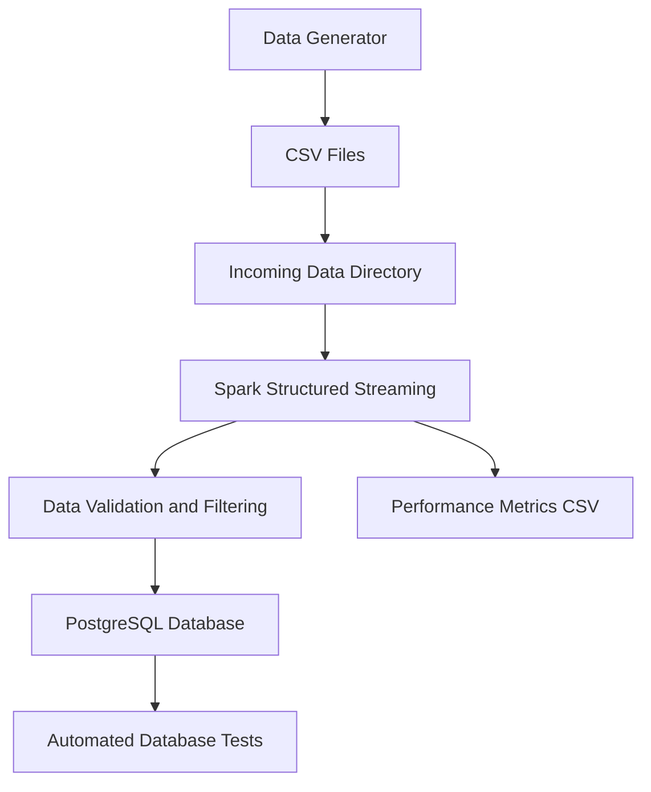

# Real-Time E-Commerce Data Ingestion Pipeline

A real-time data ingestion pipeline built with **Apache Spark Structured Streaming** and **PostgreSQL**. The project simulates e-commerce events, processes incoming CSV files incrementally, validates records, and stores valid events in a PostgreSQL database.

## 1. Project Overview

This project demonstrates how to build a real-time data ingestion workflow using Apache Spark Structured Streaming.

The pipeline:
- Generates simulated e-commerce events continuously.
- Writes events into timestamped CSV files.
- Reads incoming files incrementally using Spark Structured Streaming.
- Validates and filters incoming records, counting the rejected ones.
- Inserts valid records into PostgreSQL.
- Prevents duplicate event IDs.
- Tracks batch processing performance and end-to-end latency.

## 2. System Architecture



## 3. Technologies Used

| Technology | Purpose |
|---|---|
| Python | Data generation and pipeline implementation |
| Apache Spark 4.0.1 | Structured Streaming and data processing |
| PostgreSQL | Persistent event storage |
| psycopg2 | PostgreSQL connectivity |
| python-dotenv | Environment variable management |
| pytest | Automated testing |
| Git | Version control |

## 4. Project Structure

```text
Real-Time-Data-Ingestion/
│
├── docs/
│   ├── project_overview.md
│   ├── system_architecture.md
│   ├── system_architecture.png
│   ├── test_cases.md
│   └── user_guide.md
│
├── reports/
│   ├── performance_metrics.md
│   ├── streaming_metrics.csv
│   ├── metrics_baseline_run.csv
│   └── metrics_load_run.csv
│
├── scripts/
│   ├── data_generator.py
│   ├── spark_streaming_to_postgres.py
│   ├── measure_performance.py
│   └── run_pipeline.py
│
├── sql/
│   └── postgres_setup.sql
│
├── tests/
│   ├── test_pipeline.py
│   ├── test_generator.py
│   └── test_transformations.py
│
├── data/
│   └── incoming/
│
├── checkpoint/
│
├── .env
├── .env.example
├── .gitignore
├── postgres_connection_details.txt
├── requirements.txt
└── README.md
```

## 5. Prerequisites

Before running the project, ensure you have:

- Python 3.10 or later
- Java 17 or later
- Apache Spark (installed through the PySpark dependency)
- PostgreSQL
- Git

**Windows configuration:** Spark on Windows needs `winutils.exe`. By default the script looks for it at `D:\hadoop\bin\winutils.exe`. If yours is elsewhere, set `HADOOP_HOME` (the folder that contains `bin\winutils.exe`) in `.env` or your shell. On other operating systems this is ignored.

## 6. Installation and Setup

### Step 1: Clone the Repository

```bash
git clone https://github.com/MugaboVedaste/Real-Time-Data-Ingestion.git
cd Real-Time-Data-Ingestion
```

### Step 2: Create a Virtual Environment

Windows PowerShell:

```powershell
python -m venv .venv
.venv\Scripts\Activate.ps1
```

Git Bash:

```bash
python -m venv .venv
source .venv/Scripts/activate
```

### Step 3: Install Dependencies

```bash
python -m pip install -r requirements.txt
```

### Step 4: Configure PostgreSQL

Create the database:

```bash
psql -U postgres -c "CREATE DATABASE ecommerce_streaming;"
```

Then create the events table, with its constraints and indexes:

```bash
psql -U postgres -d ecommerce_streaming -f sql/postgres_setup.sql
```

The table structure is:

```sql
CREATE TABLE IF NOT EXISTS user_events (
    event_id BIGINT PRIMARY KEY,
    user_id BIGINT NOT NULL,
    product_id BIGINT NOT NULL,
    event_type VARCHAR(20) NOT NULL
        CHECK (event_type IN ('view', 'add_to_cart', 'purchase')),
    price NUMERIC(10, 2) NOT NULL CHECK (price > 0),
    event_time TIMESTAMP NOT NULL,
    ingestion_time TIMESTAMP DEFAULT CURRENT_TIMESTAMP
);
```

The script also creates indexes on `event_time` and `event_type`.

### Step 5: Configure Environment Variables

Copy `.env.example` to `.env` in the project root and edit it:

```env
POSTGRES_HOST=localhost
POSTGRES_PORT=5432
POSTGRES_DB=ecommerce_streaming
POSTGRES_USER=postgres
POSTGRES_PASSWORD=your_postgres_password
```

Replace the example password with your actual PostgreSQL password.

Optional settings (see `.env.example`): `HADOOP_HOME`, `MAX_FILES_PER_TRIGGER` (default 10) and `TRIGGER_INTERVAL` (default `5 seconds`).

**Important:** Never commit your `.env` file or expose database credentials. `postgres_connection_details.txt` contains placeholders only.

## 7. Running the Pipeline

The pipeline uses two separate processes: the data generator and the Spark streaming application. You can start them together with one command (Option A) or run each yourself in its own terminal (Option B).

### Option A: Run everything with one command

From the project root, with the virtual environment active:

```bash
python scripts/run_pipeline.py
```

`run_pipeline.py` is a thin launcher. It starts `spark_streaming_to_postgres.py`, waits until Spark is ready, starts `data_generator.py`, and on `CTRL+C` stops both and prints a performance summary for that session (using `measure_performance.py`). It does not replace the individual scripts, which still work on their own.

Options:

| Flag | Meaning |
|---|---|
| `--events N` | Events per CSV file (default 10) |
| `--interval SECONDS` | Seconds between files (default 5) |
| `--files N` | Generate N files, let Spark finish, then exit (default: run until `CTRL+C`) |
| `--no-measure` | Skip the performance summary at the end |

Example, a heavier load test that stops by itself:

```bash
python scripts/run_pipeline.py --events 500 --interval 1 --files 40
```

### Option B: Run each script manually

#### Terminal 1: Start the Spark Application

From the project root:

```bash
python scripts/spark_streaming_to_postgres.py
```

Expected startup messages:

```text
Spark Structured Streaming started successfully!
Waiting for incoming events...
Spark UI: http://localhost:4040
```

#### Terminal 2: Start the Data Generator

Open another terminal, activate the virtual environment, navigate to the project root, and run:

```bash
python scripts/data_generator.py
```

The generator continuously creates CSV files containing 10 simulated e-commerce events every 5 seconds. Files are written to a hidden temporary name and then renamed, so Spark never reads a half-written file.

Optional flags: `--events N` (events per file), `--interval SECONDS` and `--files N` (stop after N files). For a heavier load test:

```bash
python scripts/data_generator.py --events 500 --interval 1 --files 40
```

Spark detects and processes incoming files incrementally.

## 8. Data Processing and Validation

The pipeline supports three event types:

- `view`
- `add_to_cart`
- `purchase`

Incoming records are validated to ensure:

- Event ID, user ID, and product ID are present.
- Event type is supported.
- Price is greater than zero.
- Event timestamp is valid (a malformed timestamp becomes NULL and the row is rejected instead of crashing the job).

The number of rejected records is printed for each batch and stored in the metrics file. Duplicate event IDs are prevented using PostgreSQL's primary key and:

```sql
ON CONFLICT (event_id) DO NOTHING
```

## 9. Monitoring and Performance

### Spark Web UI

While the Spark application is running, access:

http://localhost:4040

### Performance Metrics

Batch processing metrics are recorded in:

```text
reports/streaming_metrics.csv
```

The metrics include:

- Processing timestamp
- Batch ID
- Number of processed records
- Number of inserted records
- Number of rejected records
- Batch processing duration

To summarise throughput, batch times and end-to-end latency (`ingestion_time - event_time`):

```bash
python scripts/measure_performance.py
```

A performance summary is available in:

```text
reports/performance_metrics.md
```

## 10. Database Validation

Connect to PostgreSQL:

```bash
psql -U postgres -d ecommerce_streaming
```

Check the total number of events:

```sql
SELECT COUNT(*) FROM user_events;
```

Check event distribution:

```sql
SELECT event_type, COUNT(*)
FROM user_events
GROUP BY event_type;
```

Check the latest events:

```sql
SELECT *
FROM user_events
ORDER BY event_time DESC
LIMIT 10;
```

Check for duplicate event IDs:

```sql
SELECT event_id, COUNT(*)
FROM user_events
GROUP BY event_id
HAVING COUNT(*) > 1;
```

## 11. Running Tests

Ensure PostgreSQL is running, your `.env` file is configured, and the `user_events` table exists.

Run:

```bash
python -m pytest tests/ -v
```

The automated tests validate:

1. PostgreSQL connectivity, event records, duplicate prevention, valid event types, positive prices and required fields (`test_pipeline.py`, needs PostgreSQL with data).
2. CSV generation: header, row count, valid values, unique IDs, no leftover temp files (`test_generator.py`).
3. The Spark cleaning logic against valid and deliberately invalid rows (`test_transformations.py`, needs Java and PySpark only).

See [Test Cases](docs/test_cases.md) for more details.

## 12. Stopping the Applications

If you used `run_pipeline.py`, press `CTRL+C` once in its terminal. It stops both processes and prints the performance summary.

If you started the scripts manually, press `CTRL+C` in the data generator terminal, then in the Spark application terminal.

## 13. Project Documentation

Additional documentation is available in the `docs/` and `reports/` directories:

- [Project Overview](docs/project_overview.md)
- [System Architecture](docs/system_architecture.md)
- [System Architecture Diagram](docs/system_architecture.png)
- [User Guide](docs/user_guide.md)
- [Test Cases](docs/test_cases.md)
- [Performance Metrics](reports/performance_metrics.md)
- [Connection Details](postgres_connection_details.txt)

## 14. Limitations

- The project uses simulated e-commerce events rather than a live production data source.
- CSV files are used as the streaming input source.
- The current Spark configuration targets a local Windows development environment.
- Performance measurements depend on the local machine, database, and test workload.

## 15. Future Improvements

- Introduce Apache Kafka as a real-time event source.
- Containerize the application using Docker.
- Add automated CI/CD workflows.
- Improve monitoring and alerting.
- Deploy the pipeline to a cloud environment.

---

**Author:** [MugaboVedaste](https://github.com/MugaboVedaste)  
**Repository:** https://github.com/MugaboVedaste/Real-Time-Data-Ingestion  
**Project:** Real-Time E-Commerce Data Ingestion Pipeline  
**Processing Engine:** Apache Spark Structured Streaming  
**Database:** PostgreSQL