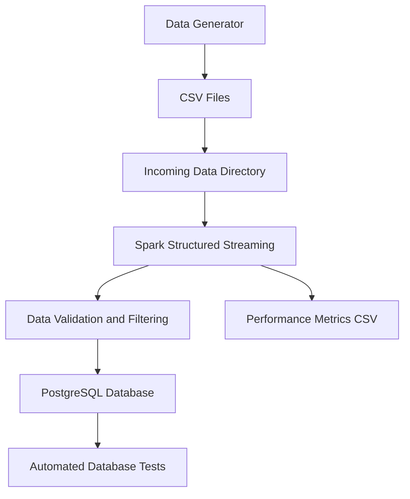

# Real-Time E-Commerce Data Ingestion Pipeline

A real-time data ingestion pipeline built with **Apache Spark Structured Streaming** and **PostgreSQL**. The project simulates e-commerce events, processes incoming CSV files incrementally, validates records, and stores valid events in a PostgreSQL database.

## 1. Project Overview

This project demonstrates how to build a real-time data ingestion workflow using Apache Spark Structured Streaming.

The pipeline:
- Generates simulated e-commerce events continuously.
- Writes events into timestamped CSV files.
- Reads incoming files incrementally using Spark Structured Streaming.
- Validates and filters incoming records.
- Inserts valid records into PostgreSQL.
- Prevents duplicate event IDs.
- Tracks batch processing performance.

## 2. System Architecture



## 3. Technologies Used

| Technology | Purpose |
|---|---|
| Python | Data generation and pipeline implementation |
| Apache Spark 4.0.1 | Structured Streaming and data processing |
| PostgreSQL | Persistent event storage |
| psycopg2 | PostgreSQL connectivity |
| python-dotenv | Environment variable management |
| pytest | Automated testing |
| Git | Version control |

## 4. Project Structure

```text
Real-Time-Data-Ingestion/
│
├── docs/
│   ├── project_overview.md
│   ├── system_architecture.md
│   ├── system_architecture.png
│   ├── test_cases.md
│   └── user_guide.md
│
├── reports/
│   ├── performance_metrics.md
│   └── streaming_metrics.csv
│
├── scripts/
│   ├── data_generator.py
│   └── spark_streaming_to_postgres.py
│
├── sql/
│   └── postgres_setup.sql
│
├── tests/
│   └── test_pipeline.py
│
├── data/
│   └── incoming/
│
├── checkpoint/
│
├── .env
├── .gitignore
├── requirements.txt
└── README.md
```

## 5. Prerequisites

Before running the project, ensure you have:

- Python 3.10 or later
- Java 17 or later
- Apache Spark (installed through the PySpark dependency)
- PostgreSQL
- Git

**Windows configuration:** The current Spark script uses Hadoop utilities located at `D:\hadoop`. Ensure `winutils.exe` exists at `D:\hadoop\bin\winutils.exe`, or adjust the Hadoop configuration in the Spark script to match your environment.

## 6. Installation and Setup

### Step 1: Clone the Repository

```bash
git clone <YOUR_GITHUB_REPOSITORY_URL>
cd Real-Time-Data-Ingestion
```

Replace the placeholder with your actual GitHub repository URL.

### Step 2: Create a Virtual Environment

Windows PowerShell:

```powershell
python -m venv .venv
.venv\Scripts\Activate.ps1
```

Git Bash:

```bash
python -m venv .venv
source .venv/Scripts/activate
```

### Step 3: Install Dependencies

```bash
python -m pip install -r requirements.txt
```

### Step 4: Configure PostgreSQL

Create the database:

```sql
CREATE DATABASE ecommerce_streaming;
```

Connect to the database and create the events table by executing:

```bash
psql -U postgres -d ecommerce_streaming -f sql/postgres_setup.sql
```

The table structure is:

```sql
CREATE TABLE IF NOT EXISTS user_events (
    event_id BIGINT PRIMARY KEY,
    user_id BIGINT NOT NULL,
    product_id BIGINT NOT NULL,
    event_type VARCHAR(20) NOT NULL,
    price NUMERIC(10, 2) NOT NULL,
    event_time TIMESTAMP NOT NULL,
    ingestion_time TIMESTAMP DEFAULT CURRENT_TIMESTAMP
);
```

### Step 5: Configure Environment Variables

Create a `.env` file in the project root:

```env
POSTGRES_HOST=localhost
POSTGRES_PORT=5432
POSTGRES_DB=ecommerce_streaming
POSTGRES_USER=postgres
POSTGRES_PASSWORD=your_postgres_password
```

Replace the example password with your actual PostgreSQL password.

**Important:** Never commit your `.env` file or expose database credentials.

## 7. Running the Pipeline

The pipeline uses two separate processes: the data generator and the Spark streaming application.

### Terminal 1: Start the Spark Application

From the project root:

```bash
python scripts/spark_streaming_to_postgres.py
```

Expected startup messages:

```text
Spark Structured Streaming started successfully!
Waiting for incoming events...
Spark UI: http://localhost:4040
```

### Terminal 2: Start the Data Generator

Open another terminal, activate the virtual environment, navigate to the project root, and run:

```bash
python scripts/data_generator.py
```

The generator continuously creates CSV files containing 10 simulated e-commerce events every 5 seconds.

Spark detects and processes incoming files incrementally.

## 8. Data Processing and Validation

The pipeline supports three event types:

- `view`
- `add_to_cart`
- `purchase`

Incoming records are validated to ensure:

- Event ID, user ID, and product ID are present.
- Event type is supported.
- Price is greater than zero.
- Event timestamp is valid.

Duplicate event IDs are prevented using PostgreSQL's primary key and:

```sql
ON CONFLICT (event_id) DO NOTHING
```

## 9. Monitoring and Performance

### Spark Web UI

While the Spark application is running, access:

http://localhost:4040

### Performance Metrics

Batch processing metrics are recorded in:

```text
reports/streaming_metrics.csv
```

The metrics include:

- Processing timestamp
- Batch ID
- Number of processed records
- Number of inserted records
- Batch processing duration

A performance summary is available in:

```text
reports/performance_metrics.md
```

## 10. Database Validation

Connect to PostgreSQL:

```bash
psql -U postgres -d ecommerce_streaming
```

Check the total number of events:

```sql
SELECT COUNT(*) FROM user_events;
```

Check event distribution:

```sql
SELECT event_type, COUNT(*)
FROM user_events
GROUP BY event_type;
```

Check the latest events:

```sql
SELECT *
FROM user_events
ORDER BY event_time DESC
LIMIT 10;
```

Check for duplicate event IDs:

```sql
SELECT event_id, COUNT(*)
FROM user_events
GROUP BY event_id
HAVING COUNT(*) > 1;
```

## 11. Running Tests

Ensure PostgreSQL is running, your `.env` file is configured, and the `user_events` table exists.

Run:

```bash
python -m pytest tests/ -v
```

The automated tests validate:

1. PostgreSQL database connectivity.
2. Existence of event records.
3. Duplicate event prevention.
4. Valid event types.
5. Positive event prices.
6. Required fields are not NULL.

See [Test Cases](docs/test_cases.md) for more details.

## 12. Stopping the Applications

Press `CTRL+C` in the data generator terminal.

Press `CTRL+C` in the Spark application terminal.

## 13. Project Documentation

Additional documentation is available in the `docs/` and `reports/` directories:

- [Project Overview](docs/project_overview.md)
- [System Architecture](docs/system_architecture.md)
- [System Architecture Diagram](docs/system_architecture.png)
- [User Guide](docs/user_guide.md)
- [Test Cases](docs/test_cases.md)
- [Performance Metrics](reports/performance_metrics.md)

## 14. Limitations

- The project uses simulated e-commerce events rather than a live production data source.
- CSV files are used as the streaming input source.
- The current Spark configuration targets a local Windows development environment.
- Performance measurements depend on the local machine, database, and test workload.

## 15. Future Improvements

- Introduce Apache Kafka as a real-time event source.
- Containerize the application using Docker.
- Add automated CI/CD workflows.
- Improve monitoring and alerting.
- Deploy the pipeline to a cloud environment.

---

**Project:** Real-Time E-Commerce Data Ingestion Pipeline  
**Processing Engine:** Apache Spark Structured Streaming  
**Database:** PostgreSQL