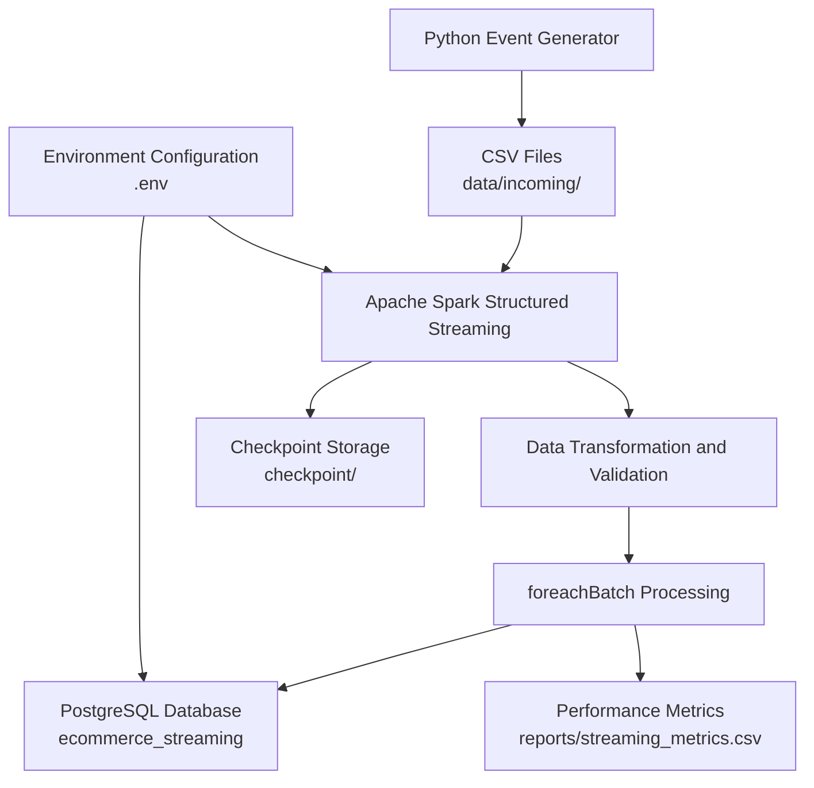

# System Architecture – Real-Time Data Ingestion Pipeline

## 1. Architecture Overview

The system follows a streaming data ingestion architecture. Python generates simulated e-commerce events and saves them as CSV files. Apache Spark Structured Streaming continuously monitors the incoming data directory, processes new files in micro-batches, validates the records, and inserts valid events into PostgreSQL.

The pipeline also uses checkpointing to track processing progress and a CSV metrics file to monitor performance.

## 2. Architecture Diagram

## 3. Component Descriptions

| Component | Description |
|---|---|
| Python Event Generator | Generates simulated e-commerce events such as views, add-to-cart actions, and purchases. |
| CSV Files | Temporarily store generated events in the `data/incoming/` directory. |
| Spark Structured Streaming | Monitors the incoming directory and processes new CSV files. |
| Data Transformation and Validation | Parses timestamps, checks required fields, validates event types, and filters invalid records. |
| foreachBatch | Processes streaming